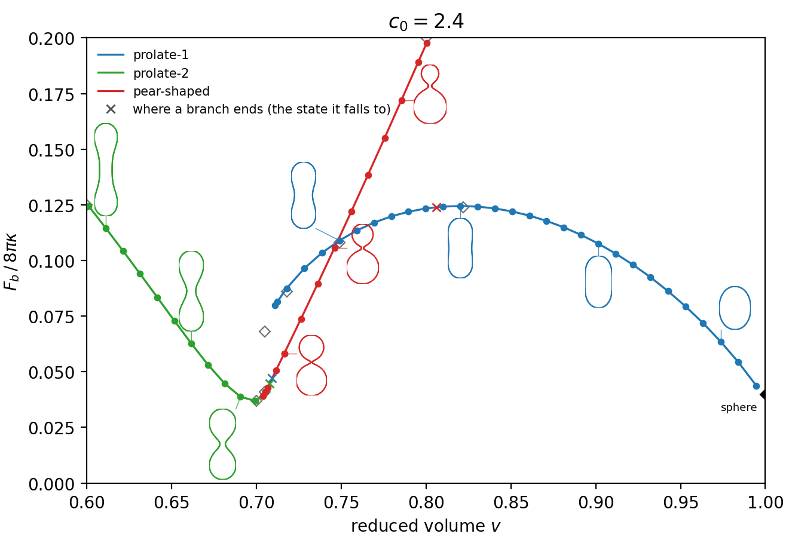
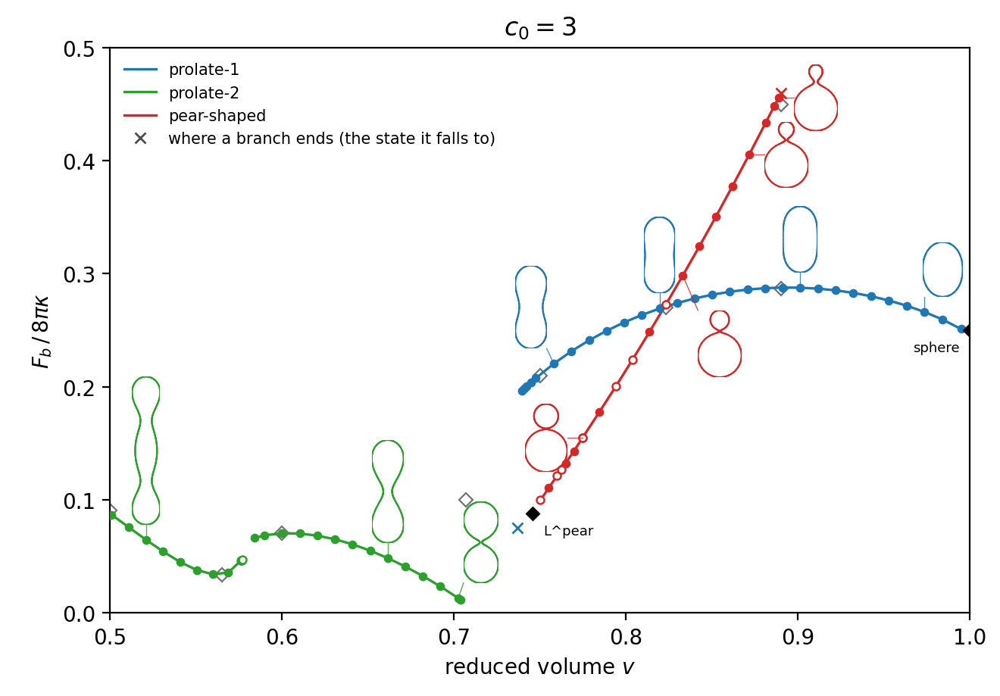
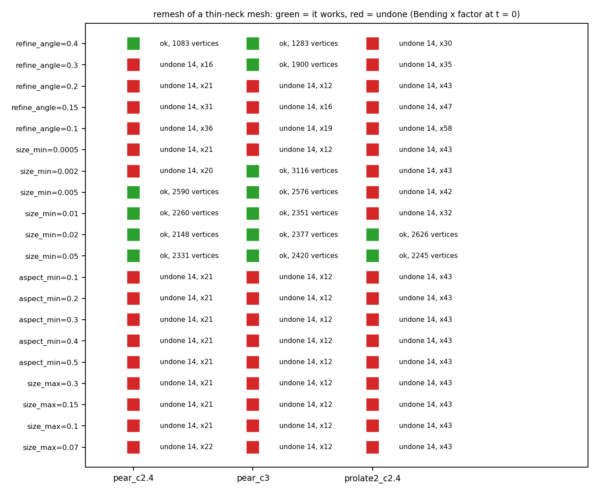
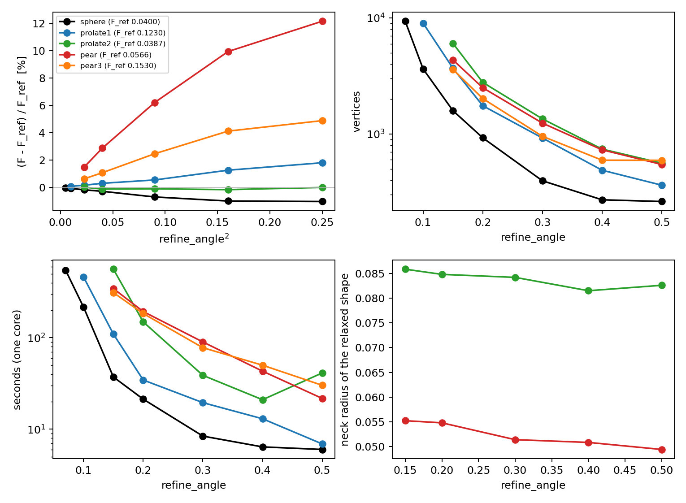

# Energy of each branch of vesicle shapes (Seifert, Berndl, Lipowsky 1991, Figs. 11 and 13)

*Shape transformations of vesicles: Phase diagram for spontaneous-curvature and bilayer-coupling models*, Phys. Rev. A **44**, 1182 (1991) (`~/Documents/DDG/Membrane_shape_analitical.pdf`).
The shapes of lowest bending energy at a fixed area and volume for a spontaneous curvature `C0`. Fig. 10 is the phase diagram, Figs. 9, 12 and 14 are the shapes, and **Figs. 11 (c0 = 2.4) and 13
(c0 = 3) are the energy `F_b / 8 pi kappa` of every *branch* of stationary shapes against the reduced volume `v`**: prolate-1, prolate-2 and the asymmetric pear-shaped branch, also where a branch is not
the lowest one. This study computes those curves with chains: **one chain per branch**, every `v` relaxed from the previous one.

| file | what |
|---|---|
| `Templates/Shape_chain.txt` | the config every link is built from (Bending, volume and area constraint, BFGS then BFGS-Normal, quality remeshing, the `stopping` block; `size_min` 0.005) |
| `Scripts/Run_shape_chain.py` | what a job runs: seed, link 0, the legs up and down in `v`, checks, branch-end detection, resume |
| `Scripts/Create_subjob_shape_chain.py` | writes the config, the chain file and the sbatch job of one chain; presets of seeds and ranges for c0 = 2.4 and 3 |
| `Scripts/Mem_shape_study.sh` | **the launcher of all chains on the cluster** (tcsh); optionally also the mesh study |
| `Scripts/Analyze_shape_chains.py` | the figures with the shapes on the curves, the tables, the exported numbers and meshes, the check against the continuum solver |
| `Scripts/Shape_axisym.py` | the 1D axisymmetric continuum solver (reference energies) |
| `Scripts/Render_shape_obj.py` | shaded pictures of the meshes, matplotlib only |
| `Scripts/Study_shape_mesh.py`, `Create_subjob_shape_study.py` | the study of the remesher settings and the remesh stress test (section 5) |

## 1. Units: what the code's `Bending` is in the paper's variables (checked)

The paper: `F_b = (kappa/2) int (C1 + C2 - C0)^2 dA`, `v = V / (4 pi/3 R0^3)`, `c0 = C0 R0`, `R0 = sqrt(A / 4 pi)`, and `F_b / 8 pi kappa` is `1` for a sphere with `C0 = 0`.
The code: `Bending` `[KB, H0]` is `KB int (H - H0)^2 dA` with `H = mean_curv / dual_area`, and `mean_curv = 0.25 sum theta l` (`BendingGeometry::compute`) is *half* of geometry-central's, so
**`H = (C1 + C2)/2`** (a sphere has `H = 1/R`). Tested on closed icospheres:

| mesh (vertices, edge) | `Bending / 4 pi` at `H0 = 0` (exact 1) | at `H0 = c0/(2 R0)`, c0 = 2.4 (exact 0.04) |
|---|---|---|
| 162, 0.161 | 1.00677 | 0.03907 |
| 642, 0.082 | 1.00171 | 0.03980 |
| 2562, 0.041 | 1.00043 | 0.03995 |

(the error falls by 4 per halving of the edge: `h^2`). So `kappa = KB/2`, `C0 = 2 H0`, and

    H0 = c0 / (2 R0),     F_b / (8 pi kappa) = Bending / (4 pi KB).

`c0` is **not** equal to `H0` in the config: it is, only for `R0 = 1/2` (area `pi`); the meshes here have `A ~ 3.7` (`R0 ~ 0.55`), so `H0 = 0.92 c0`, and `R0` changes with `v` along a chain (the volume is
fixed, `A = (36 pi V^2 / v^2)^(1/3)`). The runner computes `H0` from the target `v` of every link. A run with `H0 = 3.0` on a mesh of area 3.6 to 3.8 has `c0 = 3.2` to `3.3`, not 3.

The constraints are penalties (`K = 1e4`), so the `v` that is reached is a little off the target (0.0005 to 0.005). A penalty minimum is a constrained minimum at the area and volume that were reached
(the forces balance with the multipliers), so `F_b` is exact at that `v` (and `c0_eff = 2 H0 sqrt(A / 4 pi)`, recorded, differs from c0 by less than 0.1 percent): **the curves are drawn against the `v` that was
reached**.

## 2. Branches, seeds and chains

A minimiser only finds local minima, so a branch is followed for as long as it is one: **a chain starts from a shape of the branch and walks `v` until the branch stops being a minimum**.
The seeds are surfaces of revolution of volume `V0 = 0.5035` (that of `input/Asym_cil_regular.obj`, so the absolute lengths of the remesher settings mean the same in every chain).
Walking *up* shrinks the target area, the stable direction of the flow; walking down grows it. Steps are 0.01 (0.005 for the pears' way down), halved where the shape changes class.

| chain (folder) | seed | walks |
|---|---|---|
| `prolate1` | capsule (cylinder with caps) of reduced volume 0.70, relaxed at `v0` = 0.74 (c0 2.4) / 0.85 (c0 3) | up to 0.99 and down until the branch ends |
| `prolate2` | long capsule (0.55 / 0.40) relaxed at 0.60 / 0.50 | up (c0 2.4: to 0.72; c0 3: to 0.62) until it loses its symmetry |
| `prolate2b` (c0 3) | capsule 0.55 relaxed at 0.62 | up to 0.72, where the neck closes |
| `pear` | two spheres joined by a rolling-ball fillet (radii 1.3 and neck 0.2 at c0 2.4; 2 and 0.3 at c0 3), relaxed at 0.72 / 0.78 | **up** to M^pear |
| `pearb` | the same seed | **down** (0.005) until the pear becomes symmetric (c0 2.4) or its neck closes (c0 3) |

**The seed must be smooth.** Two overlapping spheres have a crease (a circle of enormous curvature) and the remesher refines it to edges of a thousandth of the neck radius; the pear seed is two spheres
joined by a toroidal throat tangent to both.

**Every link is checked**: the run converged or reached the step cap (`status` converged / capped; a run that *ended* early is a failure), finite energies, the volume within 0.5 percent and `v` within 0.006 of the target,
and the shape is compared with the link before: the neck ratio (smallest radius of the profile over the smaller outer lobe), the lobe ratio (smaller over larger of the two largest lobes) and the skewness of the
area along the axis (0 for an up-down symmetric shape). **When one of them jumps the branch has ended**: the step is halved and the link repeated from the last good one, down to an eighth; the link that
still jumps is saved as the landing (kind `jump`: the state the branch fell to; the `x` of the figures) and the leg stops. A leg also stops when a pear becomes symmetric. A failing link is repeated with half the
step, and a leg whose relaxation keeps failing stops (a neck that is closing). Unstable segments of the branches are not followed.

## 3. Results

Points of the curves next to the points of the paper's figures *read off the plots* (about +-0.003 in `F`, +-0.005 in `v`) and the exact values of the theory:

| c0 = 2.4 | v (ours) | F (ours) | v (paper) | F (paper) |
|---|---|---|---|---|
| prolate-1 maximum | 0.820 | 0.1245 | 0.822 | 0.124 |
| D^pear (pear = prolate-1) | 0.748 | 0.1082 | 0.749 | 0.108 |
| prolate-2 minimum | 0.697 | 0.0365 | 0.700 | 0.037 |
| M^pear (pear branch ends, falls onto prolate-1) | 0.800 | 0.1977 | 0.800 | 0.200 |
| sphere, exact | 1 | 0.0400 | | (ours at v = 0.9947: 0.0437) |

| c0 = 3 | v (ours) | F (ours) | v (paper) | F (paper) |
|---|---|---|---|---|
| prolate-1 maximum | 0.894 | 0.2878 | 0.890 | 0.287 |
| D^pear | 0.822 | 0.2705 | 0.823 | 0.270 |
| prolate-2 minimum | 0.562 | 0.0337 | 0.565 | 0.033 |
| M^pear | 0.889 | 0.4560 | 0.890 | 0.450 |
| sphere, exact | 1 | 0.2500 | | (ours at v = 0.9948: 0.2511) |
| budding limit L^pear, exact | 0.7458 | 0.0877 | | (the pear branch gets to 0.7503, 0.0994) |

(`fig11_landmarks.md`, `fig13_landmarks.md`; the exact values: `F = (1 - c0/2)^2` for the sphere, and L^pear from `1/R1 + 1/R2 = C0`, `R1^2 + R2^2 = R0^2`, `R1^3 + R2^3 = v R0^3`, eq. 5.4.)

**What each branch does**
* **prolate-1** is a peanut that rounds off into the sphere. At c0 = 2.4 it is followed down to `v` = 0.711 (F = 0.0798); it falls to the pear between 0.7137 and 0.7125 (the paper puts the bifurcation C1^pear at 0.718, where the symmetric
  shape becomes a saddle: the symmetric flow keeps it a little longer, noise decides). At c0 = 3 it ends between 0.7425 and 0.7412, next to the budding limit v = 0.7458.
* **prolate-2** (two lobes and a neck) at c0 = 2.4 runs from 0.60 to 0.7053 (F = 0.0409), where it becomes a pear (the paper's C^pear is at 0.705). At c0 = 3 it comes in two pieces: from 0.50 to 0.5763 (minimum 0.0337 at 0.562)
  and from 0.62 to 0.7039 (F = 0.0110 against the exact two-spheres limit 0.0074 at 0.7071), where the neck closes. Between 0.577 and 0.62 the symmetric branch is unstable (the paper's wing and its instabilities): for targets 0.58
  to 0.595 the `v` reached stays at 0.577 and the volume constraint is not met, so a minimiser cannot follow it there.
* **pear** at c0 = 2.4 starts at the continuous bifurcation from prolate-2 (`v` = 0.704 to 0.706, the skewness goes to zero) and rises along a nearly straight line to M^pear (0.800, 0.198), where it falls onto prolate-1. At c0 = 3 it runs
  from 0.7503 (close to L^pear) to M^pear (0.889, 0.456); below 0.75 the neck closes (the links "end" with the shape stuck at 0.7503 whatever the target) and the mesh cannot follow.

**The pears** (`pears_3d.png` in `preview/`, meshes in `preview/meshes/`): the neck, measured on the meridian cut (`waist_radius`), has radius 0.023 / 0.027 / 0.033 at c0 = 2.4, v = 0.716 / 0.736 / 0.756 (5 to 7 percent of the
largest radius) and 0.004 / 0.002 at c0 = 3, v = 0.775 / 0.784: **the c0 = 3 pears are budding, their neck is almost closed**, as in the paper (at L^pear the neck has zero radius), and it is smaller than `size_min`.

**Accuracy** (`fig11_continuum.png`, `fig13_continuum.png`; `Shape_axisym.py`): the same problem solved in 1D from the shape of every point gives the continuum energy at the same `v` and c0. The 3D mesh energy at
`refine_angle` 0.2 is above it by 0.0005 to 0.0025 in `F` (the median is 0.0003 to 0.0005 for the prolates and 0.0015 to 0.0023 for the pears), at most 1 percent of the figure's axis; relative to F itself: prolate-1 -0.03 percent
(c0 2.4, median; -3 percent next to the sphere where F is 0.04) and +0.02 percent (c0 3), pear +1.6 / +0.7 percent, prolate-2 -0.4 / -0.5 percent (up to +4 / -8 percent in the last links, where F is 0.01 to 0.04 and the neck is closing).
The c0 = 2.4 pear has a continuum neck radius of 0.042 R0 and lobe radii 0.623 and 0.770 R0 (ratio 0.81), the mesh 0.042 R0 and 0.80. For the c0 = 3 pears the solver needs a smoothed start and finds a neck of about 0.01 R0
(it does not fully converge: 17 of the 71 c0 = 3 points are left out of the continuum plot).

## 4. The numbers behind the figures

Everything is in `Results/Shape_chains/c0_<c0>/<chain>/` (not in git): `chain_summary.csv` (one line per relaxation: tag, from_tag, leg, kind seed / point / jump / rejected / failed, nu_target, **nu** reached, **F** = `F_b / 8 pi kappa`,
E_total, c0_eff, H0, steps, status, seconds, nV, the shape numbers, mesh), one folder per relaxation (`<tag>/1/Final_state.obj`, `Output_data.txt`, `Convergence_log.txt`, `Input_file.json`), `seed.obj`, `chain.json`, `chain.log`.
`Analyze_shape_chains.py --data_dir` writes the numbers behind each figure (`fig11_data/`, `fig13_data/` here):
* `points.csv`: every point of every curve: branch, chain, leg, tag, kind, nu_target, **nu**, **F**, c0_eff, H0, status, steps, vertices, length and largest radius of the shape, **neck_radius** (meridian cut), neck_over_rmax,
  the 60-slab neck ratio, lobe_ratio, skew, and the mesh;
* `snapshots.csv` + `snapshots/*.obj`: the shapes drawn on the curves with their anchor `(nu, F)`, side (above / below / left / right of the point), shift and size in inches, to replace the outlines by renders;
* with `--all_meshes` every mesh as `meshes/<branch>/<branch>_nu<nu>_F<F>.obj` (`Results/Shape_chains_export/c0_<c0>/` here: 9 MB per c0, not in git).

Links whose run *ended* early are in `chain_summary.csv` but not in the curves; the two original `pear` chains also ran a down leg (a duplicate of `pearb`, partly from before the checks above): moved to `Results/Shape_chains_discarded/`.

## 5. Thin necks and the mesh

**What the remesher does.** The sizing field is the shape operator of every face (from the dihedral angles of its edges) squared and divided by `refine_angle^2`, clamped to `[1/size_max^2, 1/size_min^2]`; an edge is split when
its length times the square root of the sizing exceeds 1 **and it is longer than 2 `size_min`** (`remeshing.cpp:1349`); collapses are refused if a triangle would get an aspect ratio below `aspect_min`, flip a normal or exceed 0.9 in the
sizing metric; the remesh only splits, collapses and flips edges, it never moves the vertices tangentially. So the edge length is about `refine_angle / (largest principal curvature)` between `size_min` and `size_max`: `refine_angle` is the angle the normal turns across one
edge. At a neck of radius `r_n` the largest curvature is `1/r_n` and the edges are `refine_angle r_n` long: measured 0.012 to 0.014 for `r_n` 0.046 to 0.076 at `refine_angle` 0.2 (0.18 to 0.28 `r_n`).
BFGS-Normal moves the vertices only along the normals and does **not** remesh (`ConvergenceMonitor.h`); a corner below 0.2 rad (`has_small_angle(sim, 0.2)`) starts a *polish* (remesh, 100 gradient-descent steps, back);
every remesh is undone when a term of the energy rises by more than `max_rise` = 10 times `max(|term|, 1)`, and remeshing then pauses for 10 steps.

**How it fails.** A neck is a soft mode: it keeps narrowing and the shape keeps drifting for tens of thousands of steps. After the switch to BFGS-Normal the fixed mesh stretches with it (minimum corner 36 to 14 degrees in
about 3000 steps, edges 4:1 around the neck), the sliver guard fires, and the polish remesh splits the long edges of the needle triangles at the midpoint of the chord: the Bending goes from 1.99 to 23 (a factor 12 to 58 in
all the cases seen), the remesh is undone, ten steps later it is tried again. Up to 3373 undone remeshes and more than 100 polishes in one link, which then never converges (each polish gains 1e-3).

**The stress test** (`Study_shape_mesh.py stress_make / stress_robust`, `mesh_stress.png`; meshes in `stress_meshes/`): 150 steps from three thin-neck meshes (two pears after BFGS-Normal, a prolate-2) for 20 remesher settings,
the remesh at step 0 undone or not:

* **`size_min` is the only lever**: the remesh survives with `size_min` >= 0.005 (c0 = 2.4 pear), >= 0.002 (c0 = 3 pear), >= 0.02 (the prolate-2 mesh) and fails below. With `size_min` too small the sizing of the needles
  asks for edges below half the length of their long edges, which are then split.
* `aspect_min` (0.1 to 0.5) and `size_max` (0.07 to 0.3) change nothing: the split does not look at them.
* `refine_angle` smaller (0.15, 0.1) is worse (the jump of the Bending is larger); larger lets the pears through (0.4 for the c0 = 2.4 one, 0.3 and 0.4 for the c0 = 3 one) only because the whole mesh is coarsened (1083 to 1900 vertices
  instead of 2600) and the energy is 3.8 percent higher (2.139 against 2.061 for the c0 = 3 pear).
* The "healthy control" of this test (a prolate-2 mesh made in one long link) was not healthy: it is also a needle mesh, and needs `size_min` 0.02.

**Recommendation: `size_min` 0.005** (now the default of `Templates/Shape_chain.txt`; the SoftHour template has 0.001). The necks of the c0 = 2.4 pears ask for edges of `refine_angle r_n` = 0.005 to 0.01 (`r_n` 0.025 to 0.05), so 0.005
still lets them be resolved, and the remesh no longer blows up: the pear links run with 0 undone remeshes and 1 to 3 successful polishes. It does not change the result where the old settings worked (pear c0 = 2.4, v = 0.72: F 0.05825 against
0.05833, same neck, lobe ratio and skewness; 36754 steps instead of 50400), and it finds a lower energy where they failed (pear c0 = 3, v = 0.78: total energy 2.015 against the 2.06 the failing runs were stuck at). If a
mesh still breaks, raise `size_min` (0.01, 0.02) before touching anything else. What `size_min` cannot do is represent a neck smaller than itself: the c0 = 3 pears have `r_n` 0.002 to 0.004, the mesh has edges of at least 0.005,
and what is drawn there is the discrete neck (the energy of such a neck is almost independent of its radius: the energy matches the continuum to 1.5 percent).

**5.5 Energy against resolution** (`Study_shape_mesh.py run` / `plot`; `mesh_angle.png`, `mesh_settings.png`, `mesh_robustness.png`, `mesh_table.md`, the runs in `Results/Shape_mesh_study/`). 49 runs, each one link from the same seed at a
fixed `v` and c0 with other remesher settings (base: `refine_angle` 0.2, `size_max` 0.15, `size_min` 0.005, `aspect_min` 0.2; step cap 30000, which the thin-neck runs reach: the energy is flat, the neck still creeps).

`F_ref` is the exact value for the sphere (0.0400) and, for the others, `F0 + c refine_angle^2` through the three finest angles (it agrees with the continuum solver: prolate-1 0.1230 against 0.1230, the c0 = 3 pear 0.1530 against
0.1523 to 0.1529, the c0 = 2.4 pear 0.0567 against 0.0573, and with the paper's pear line, 0.0565 at v = 0.716). Error of the energy of the mesh relative to `F_ref`, with the cost:

| case | 0.15 | **0.2** | 0.3 | 0.4 | vertices and seconds at 0.2 |
|---|---|---|---|---|---|
| sphere (c0 2.4, v = 1) | -0.2 % | **-0.3 %** | -0.7 % | -1.0 % | 925, 21 s |
| prolate-1 (c0 2.4, v = 0.80) | +0.2 % | **+0.3 %** | +0.6 % | +1.3 % | 1750, 34 s |
| prolate-2 (c0 2.4, v = 0.69, neck about 0.085) | 0.0 % | **-0.1 %** | -0.1 % | -0.2 % | 2783, 149 s |
| pear (c0 2.4, v = 0.72, neck radius 0.023) | +1.5 % | **+2.9 %** | +6.2 % | +9.9 % | 2501, 193 s (cap) |
| pear (c0 3, v = 0.78) | +0.6 % | **+1.1 %** | +2.5 % | +4.1 % | 2018, 184 s (cap) |

* **The error goes as `refine_angle^2`** (`F = F0 + c refine_angle^2`, `c` = 0.009 for prolate-1, 0.039 and 0.042 for the pears, about 0 for prolate-2): 0.3 percent or less for the smooth shapes at 0.2, 3 and 1 percent for the pears, whose neck is where the
  curvature is. Vertices and time grow like `refine_angle^-2` to `^-3` (prolate-1: 1750 vertices and 34 s at 0.2, 9031 and 461 s at 0.1). For the energy of the c0 = 2.4 pear to 1 percent, `refine_angle` 0.1 to 0.15 or an extrapolation
  in `refine_angle^2` from two angles; the chains use 0.2.
* **`size_min` between 0.002 and 0.01 does not change the energy** (prolate-2 0.03877 / 0.03870 / 0.03876, pear 0.05833 / 0.05828 / 0.05829, c0 = 3 pear 0.15476 / 0.15462 / 0.15435 for 0.002 / 0.005 / 0.01); 0.05 under-resolves the neck:
  the c0 = 3 pear drops 2 percent (0.15125) with 258 sliver polishes, prolate-2 rises 0.9 percent with 26.
* **`size_max` (0.07 against 0.15) and `aspect_min` (0.1 to 0.4) do not matter** (0.3 percent for the c0 = 3 pear, none for prolate-1; 0.1 percent): the edges are set by the curvature, far below `size_max`.
* **Staying in BFGS with the remesher on instead of finishing in BFGS-Normal costs energy**: +0.7 percent for prolate-2 (0.03897, 24428 steps against 10228), +4.2 percent for the c0 = 2.4 pear (0.06074), +3.0 percent for the c0 = 3 pear
  (0.15922), the same with a remesh every step or every fifth: every remesh adds energy (the "kick") that the integrator has to take out again. Finish on the fixed mesh.
* **Robustness** (`mesh_robustness.png`): with `size_min` 0.005 no run failed and there was no undone remesh in the 42 runs of prolate-1, prolate-2 and the pears; they have 0 to 6 sliver polishes, except `size_min` 0.05 (26 and 258).
  (The sphere shows 6 to 37 undone remeshes of its coarse start, harmless.)

## 6. Running on the cluster

`Scripts/Mem_shape_study.sh` (tcsh, from the Scripts folder) writes and sbatches **nine independent 1-cpu jobs** (c0 2.4: prolate1, prolate2, pear, pearb; c0 3: prolate1, prolate2, prolate2b, pear, pearb), each from its own seed.
`setenv Mesh_Study 1` adds the study of the remesher settings (8 cpus). A chain that stops or hits the time limit resumes from its finished relaxations when its subjob is sbatched again; a chain that should start over needs its
folder deleted. On this machine one chain took about an hour (prolate1) to two hours or more (pears, the c0 = 3 prolate-2 chains) on one core. Options through the environment: `Prefix`, `Batch_Tag`, `Binary`, `Submit` (`echo`: only writes the jobs). Tested here with
`Submit=echo`; not run on the cluster. Copy `Results/Shape_chains/` back and run the two `Analyze_shape_chains.py` commands in the header of the script.

## 7. Caveats

* The paper's values are read off its plots (+-0.003 in F, +-0.005 in v); the exact values are not.
* Unstable segments are not followed: the wing of prolate-2 at c0 = 3 (0.577 to 0.62), the part of prolate-1 below C1^pear, the upper part of the pear branch beyond M^pear. They would need a constraint on the asymmetry.
* The c0 = 3 pear down to L^pear and prolate-2 up to L^dumb end where the neck closes; the exact limit shapes are marked, the topology change is not simulated.
* Some links reached the step cap (open dots): the energy is flat but not formally converged (relative change per 100 steps below 1e-5).
* The links of prolate-1 (both c0), of prolate-2 at c0 = 2.4 up to v = 0.70 and of the c0 = 3 prolate-2 chain from 0.50 to 0.577 used `size_min` 0.001 (the first template); all pear links, `prolate2b` and the last links of the
  c0 = 2.4 prolate-2 chain used 0.005 (the config of every chain is `Config_files/Shape_c0_<c0>_<chain>_ConfigFile.json`). Where both were tried the energies agree (pear c0 = 2.4, link 0: 0.0001), and the edges of the smooth shapes are far above `size_min`.
* The simulation binary of these runs is `Results/main_cluster_shapes_20261104` (md5 e9821ca2...): the checkout was being changed by another session (the bilayer model in `Energy_Handler`) while the chains ran.
